# Detailed Sensor Analysis

[](https://github.com/Sam-de-Ham/detailed-sensor-analysis/actions/workflows/ci.yml)
[](https://github.com/Sam-de-Ham/detailed-sensor-analysis/releases/latest)

[](https://docs.astral.sh/ruff/)
[](LICENSE)

Find out what your camera's sensor really does, from the calibration frames you already have.

Point DSA at your astrophotography folders — bias, darks, flats and lights, subs or masters,
from any number of nights and cameras. It sorts out what's there, runs every measurement the
data supports, and shows the results as numbers with uncertainties, interactive plots and maps
of the sensor you can zoom into down to single pixels. Where the data isn't enough, it says so
and tells you which frames to take.

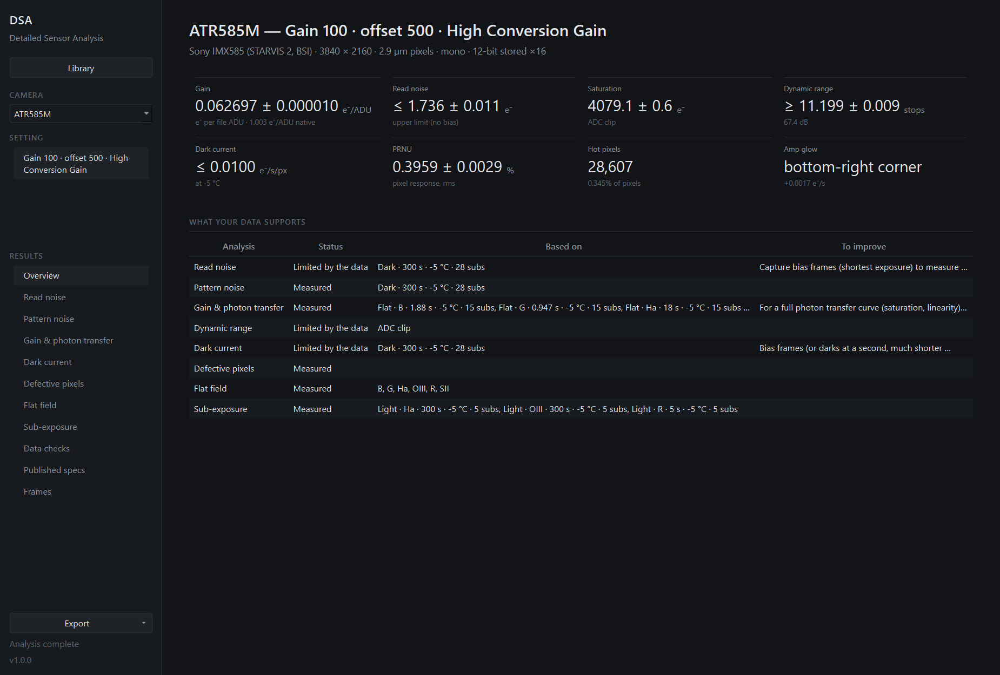

- [What it measures](#what-it-measures)
- [Gallery](#gallery)
- [Install](#install)
- [Using it](#using-it)
- [What to capture](#what-to-capture)
- [Accuracy](#accuracy)
- [How it works](#how-it-works)
- [Development](#development)

## What it measures

Each result comes with its method, its uncertainty and its limits.

- **Gain** (e⁻/ADU) from the photon transfer of flat pairs. NINA's flat wizard gives one level
  per filter; DSA treats each filter as an independent measurement and uses the vignetting
  inside each flat as a short photon transfer curve to cross-check it. With a flat series it
  also finds full well and linearity.
- **Read noise**, its spread over pixels and a map of it; **pattern noise** split into row,
  column and pixel parts, random and fixed, with spectra to find periodic banding.
- **Dark current**: from the slope over exposure, the level above bias, and the extra shot
  noise it adds — three methods that cross-check each other. Several temperatures give the
  doubling temperature. Plus a per-pixel map and **amp glow**: where, how strong, and whether
  it scales with exposure.
- **Defective pixels**: hot and warm (judged against one sub's noise, so you know which ones
  show in a single frame), dead and weak, bad columns, and **random telegraph (RTS)** pixels
  found from their time series. Exportable as a list.
- **Flat field**: pixel response non-uniformity (PRNU), **vignetting** with the fitted optical
  centre (tilt and decentring show up here), **dust** shadows with their distance from the
  sensor, colour balance of the flat light.
- **Saturation and dynamic range**, and the **sub-exposure** at which read noise stops
  mattering under your sky, measured from your lights.
- **Checks** on the data: 12-bit data stored in 16 bits, offset clipping, lossy compressed raw,
  in-camera noise filtering, cameras that clamp the dark level, masters that don't match their
  subs, drifting bias, temperature mismatches, flickering flats, missing calibration frames.
- **Comparison with published data** for the sensor where known (ToupTek/ZWO IMX585,
  photonstophotos.net for DSLRs).

Statistics are computed per Bayer colour plane, never on debayered images.

Cameras: cooled astro cameras through FITS (NINA, SharpCap, Siril masters, …) and DSLRs and
mirrorless cameras through LibRaw (CR2, CR3, ARW, NEF, DNG and more); mono and colour.

## Gallery

Everything below is real data from three cameras: a cooled ToupTek ATR585M (IMX585) through
NINA, a Sony A6400 and a Canon EOS 500D, shown as the app shows it.

| | | |
|---|---|---|
| 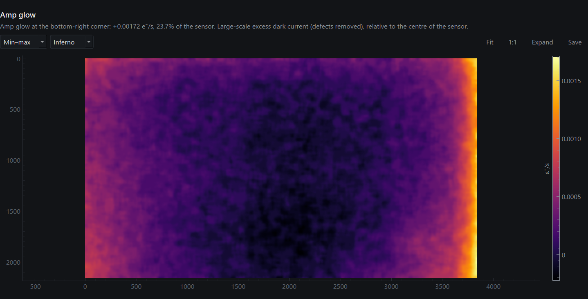<br>**Amp glow** — faint, along one edge of the IMX585 | 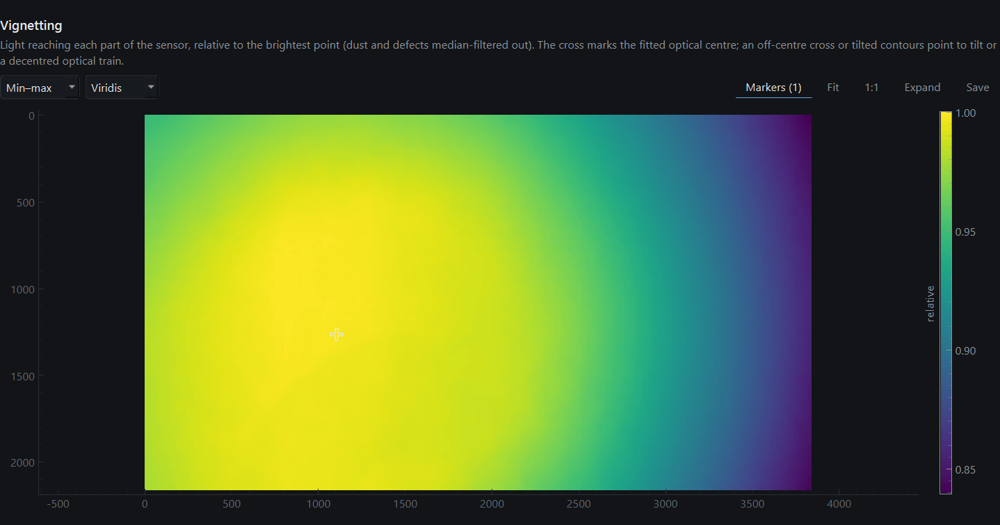<br>**Vignetting** — the optical centre sits 840 px off the sensor's | 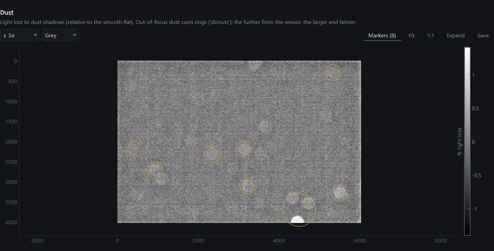<br>**Dust** — shadows found and measured on the A6400's flats |
| 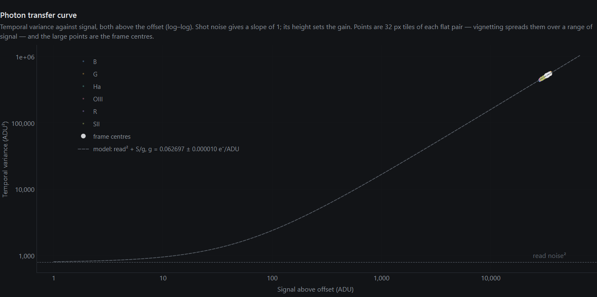<br>**Photon transfer** — six filters' flat tiles on one curve | 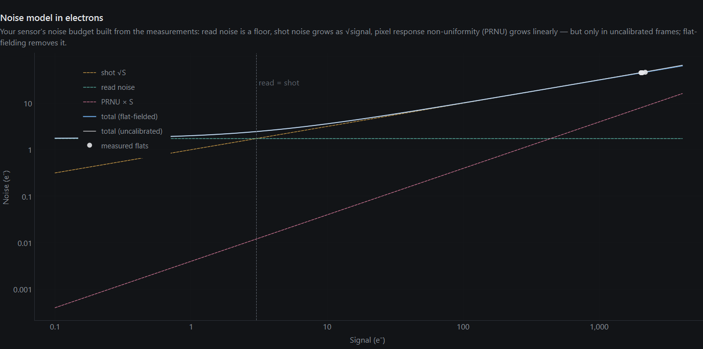<br>**Noise budget** — read, shot and PRNU noise in electrons | 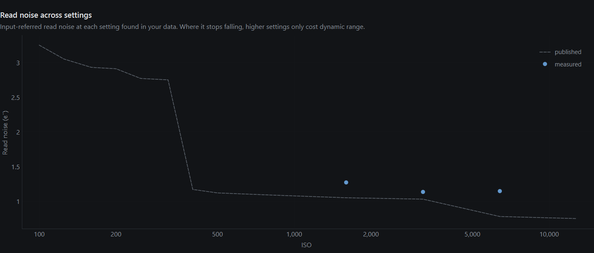<br>**Read noise vs ISO** — measured against photonstophotos.net |
| 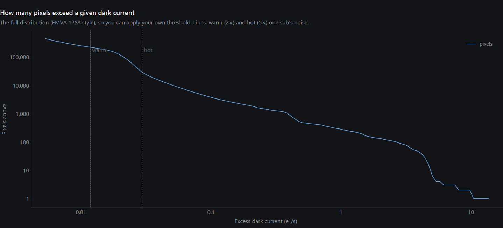<br>**Hot pixels** — the whole distribution, with the thresholds | 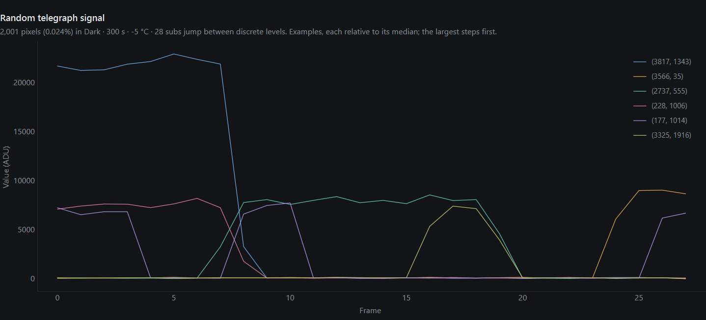<br>**RTS pixels** — pixels that jump between levels, frame by frame | 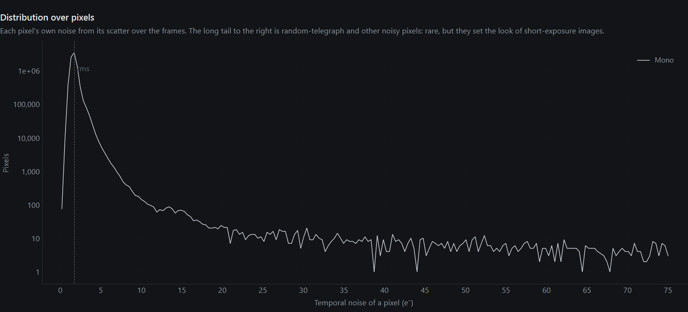<br>**Read noise per pixel** — and its long noisy tail |
| 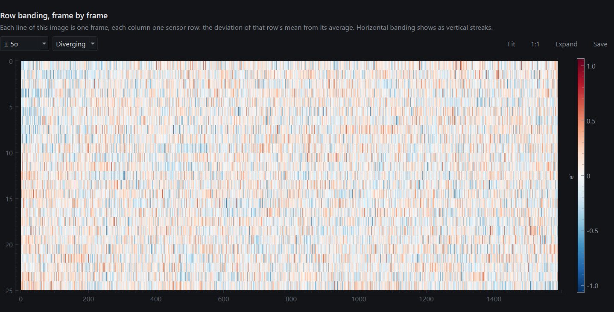<br>**Banding** — each frame's row offsets on the 500D | 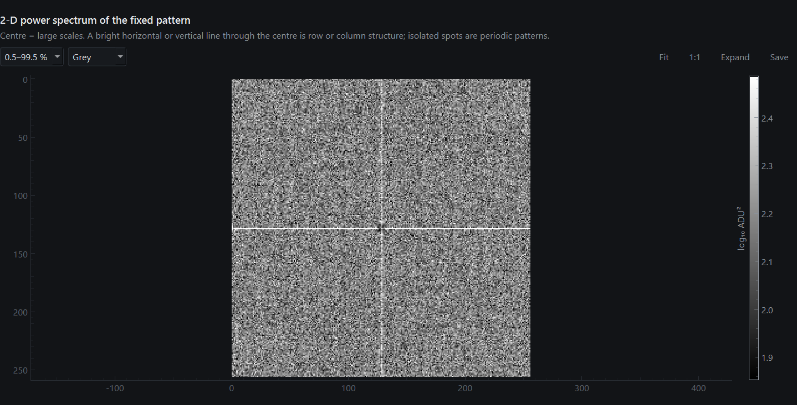<br>**Fixed pattern spectrum** — row and column structure as a cross | 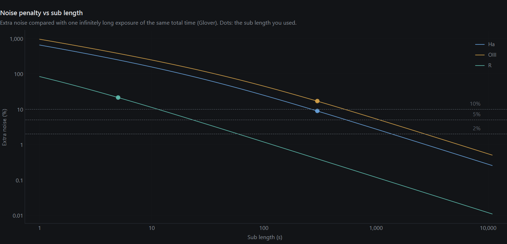<br>**Sub length** — how much read noise costs under your sky |

And the app itself:

| | |
|---|---|
| 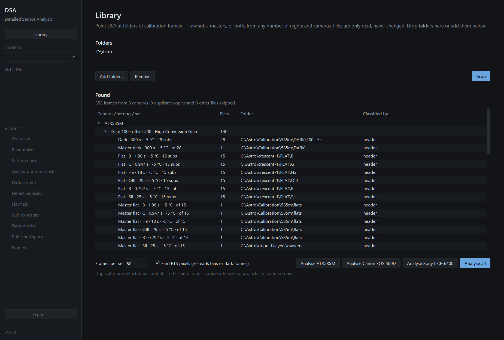 |  |
| 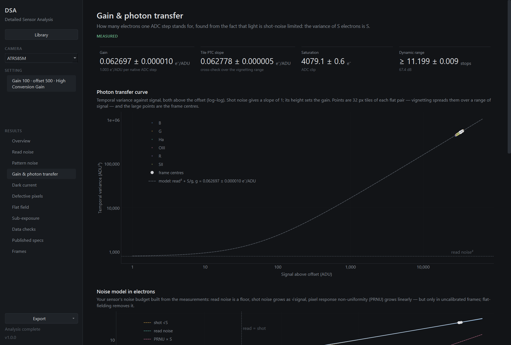 | 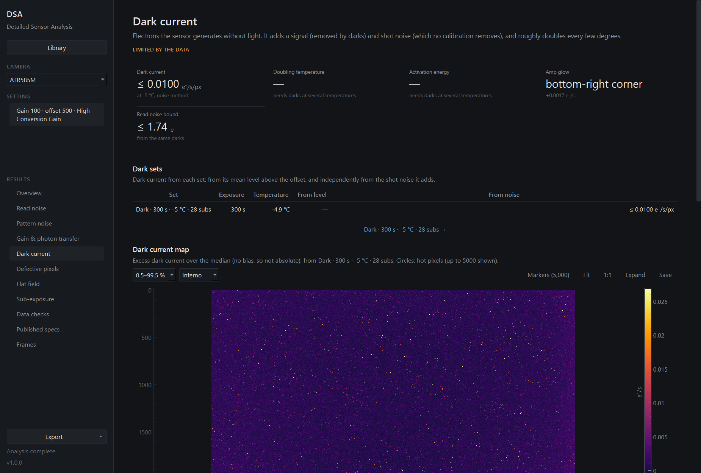 |
| 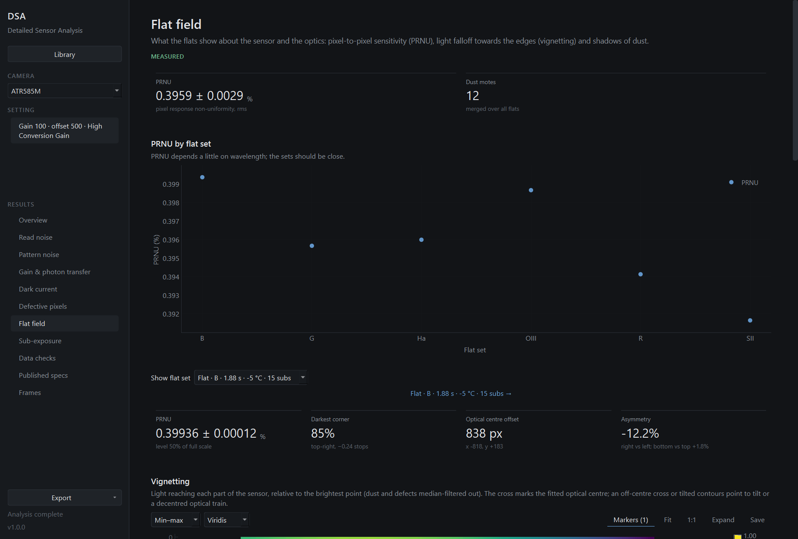 | 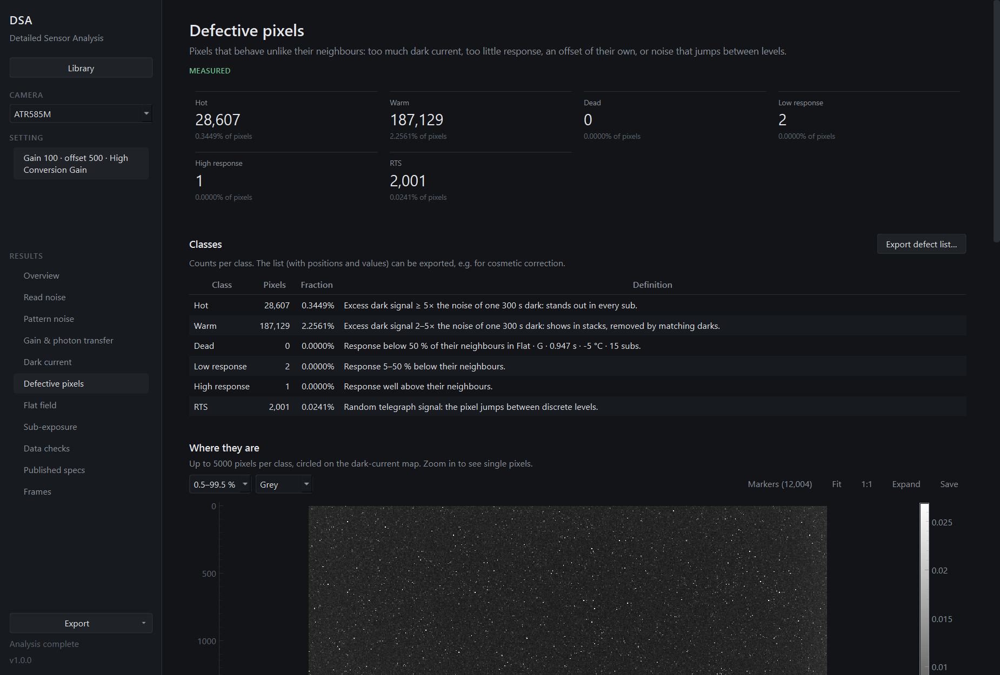 |

## Install

Windows, with [uv](https://docs.astral.sh/uv/):

```bash
git clone https://github.com/Sam-de-Ham/detailed-sensor-analysis
cd detailed-sensor-analysis
uv run dsa-gui
```

The first run sets up Python and the dependencies. macOS and Linux should work too but aren't
tested.

## Using it

1. **Library** — add folders (or drop them on the window) and press **Scan**. DSA reads file
   headers only, classifies each frame from its FITS header or, for camera raws, its folder and
   file names, and lists what it found per camera and setting. Processing output and duplicate
   copies of the same frames are skipped. Files are never changed.
2. **Analyse** a camera. Each frame set is read once and summarised; the summaries are cached,
   so a first run over tens of GB takes minutes and later ones seconds.
3. **Explore.** Pick a setting (ISO, or gain/offset/readout mode) in the sidebar. The overview
   lists the headline numbers and what your data does and doesn't support; each page goes into
   one topic. Click a number to jump to its plot, and a frame set to see the frames behind it.
   Maps zoom to single pixels with a readout of the real value under the cursor.
4. **Export** a self-contained HTML report to share (an example for the ATR585M is in
   [`examples/`](examples) — download it and open it in a browser),
   the results as JSON, the defect list as CSV, maps as PNG or FITS, and any plot as
   PNG/SVG/CSV (right-click).

From the command line:

```bash
uv run dsa scan "D:\Astro"
uv run dsa analyze "D:\Astro" --camera 585 --report out --json out
```

## What to capture

DSA works with whatever you have, but gets the most from:

| Frames | For |
|---|---|
| 20+ bias (shortest exposure, cap on) at each setting you use | read noise, pattern noise, the offset |
| darks at your sub length, plus a much shorter exposure | dark current as a slope, hot pixels, amp glow |
| darks at a few sensor temperatures | how dark current grows with temperature |
| 10+ flats per filter at 30–60 % of full scale | gain, PRNU, vignetting, dust |
| a flat series: 8–20 exposures from ~1 % to past saturation, two of each | full well, linearity |
| a few lights | your sky brightness and the best sub length |

## Accuracy

Two checks, described in [docs/validation.md](docs/validation.md):

- **Synthetic frames.** A sensor model with known gain, read noise, row noise, dark current
  (with temperature dependence, hot pixels and amp glow), RTS pixels, PRNU, vignetting, dust and
  clipping generates frames that go through the whole pipeline. The tests check that every
  planted value comes back — gain to within 1 %, read noise 2 %, dark current 3 %, PRNU 3 % —
  and that awkward data gives honest answers.
- **Real cameras against published data.** The ATR585M's measured gain is 1.003 e⁻ per 12-bit
  step, against ToupTek's 1.0; its saturation 4079 e⁻ against ~4100. The six filters' flats
  agree with each other to 0.1 %. The A6400's gain and saturation are within 5 % of
  photonstophotos.net; the remaining differences are explained in the validation notes.

The methods, references (EMVA 1288, Janesick) and published values are collected in
[docs/research.md](docs/research.md).

## How it works

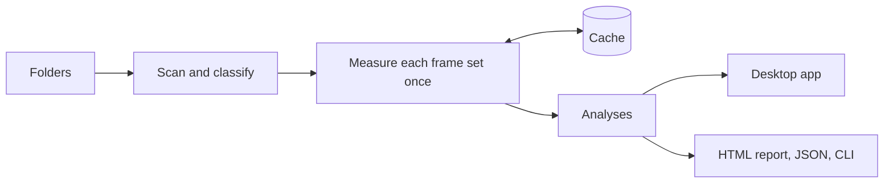

Reading a frame is the slow part, so every set is read once, decoded ahead on worker threads,
and reduced to the statistics the analyses need: per-frame levels, the variance of differences
between frame pairs (which cancels every fixed pattern), per-tile statistics of flats, and each
pixel's mean and variance over the set. More in [docs/architecture.md](docs/architecture.md).

## Development

```bash
uv sync
uv run pytest                     # including synthetic end-to-end and offscreen UI tests
uv run ruff check . && uv run ruff format --check .
```

See [CONTRIBUTING.md](CONTRIBUTING.md).

## License

[MIT](LICENSE)
