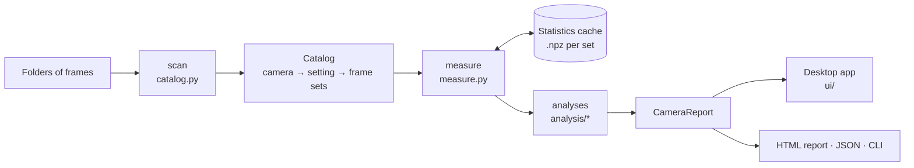

# Architecture

## Reading and grouping frames

- **`frames.py`** describes one file without reading its pixels (`FrameInfo`: type, camera,
  exposure, ISO or gain/offset/readout mode, temperature, filter, Bayer pattern, master or sub)
  and reads pixels as raw sensor values, top row first. FITS headers come first; camera raws
  have no frame type, so folder and file names (`Bias1600`, `Darks`, `MasterDark_ISO3200_40s`)
  fill in.
- **`catalog.py`** scans folder trees on worker threads, caches metadata, drops processing
  output and duplicate copies (by content: burst frames can share both timestamp and size), and
  groups frames into *modes* — one camera at one setting — and *frame sets* within them.
- **`cfa.py`** splits a Bayer mosaic into its R, G1, G2 and B planes as views. Every statistic
  is per plane; nothing is debayered.

## Measuring

**`measure.py`** reads each set once, decoding frames ahead on threads, and keeps:

- per frame and plane: levels, clipping fractions, row and column mean profiles;
- per *disjoint* pair of frames: the variance of their difference (free of every fixed
  pattern), its neighbour correlation, and for flats the same per 32 px tile;
- per pixel: temporal mean and variance;
- a histogram of raw codes (container scaling, quantisation).

The result (`SetStats`) is cached as `.npz`, keyed by the files' paths, sizes and dates, so
re-analysing a library of tens of GB takes seconds.

## Analysing

`analysis/run.py` builds a `ModeData` per mode and runs the analyses in dependency order:

1. `levels.py` — number format (container scale, bits, lossy raw) and the offset reference
   (dark flat → bias → master bias → raw black level → shortest dark, flagged);
2. `noise.py` — read noise and pattern noise;
3. `gain.py` — photon transfer gain, saturation, linearity, dynamic range (modes without
   flats borrow a scaled gain from another setting, flagged);
4. `dark.py` — dark current, temperature dependence, per-pixel map, amp glow;
5. `flat.py` — PRNU, vignetting, dust;
6. `pixels.py` — defective and RTS pixels (RTS re-reads the bias or darks);
7. `exposure.py` — sky flux and optimal sub length;
8. `quality.py` — data and calibration checks;
9. `specs.py` — comparison with published values.

Every result carries a status (*measured*, *limited by the data*, *not available*), the
method used, notes, and what extra data would improve it. Numbers are `Value`s: a value, a 1σ
statistical error, a unit, and whether it is an upper or lower limit.

## Presenting

- **`ui/`** — PyQt6 and pyqtgraph. Each page is a scrolling document built from `widgets.py`
  (key figures, captioned figures, notes). `imageview.SensorMap` shows maps at full resolution
  with display stretches (`display.py`) and overlays; `plots.Plot` adds a hover readout and
  readable log axes. Long work runs in `tasks.Task` threads.
- **`report.py`** renders a self-contained HTML report with matplotlib figures;
  **`export.py`** writes JSON; **`cli.py`** offers the same analysis without the UI.

## Testing

`synthetic.py` generates frames from a sensor model with known parameters and writes them as
NINA-style FITS. `tests/sessions.py` runs such sessions through the full pipeline; the tests
check that every planted value is recovered, that awkward data (no bias frames, clamped dark
levels, offset clipping, in-camera filtering, a full photon transfer series) gives honest
results, and that the UI builds every page.
